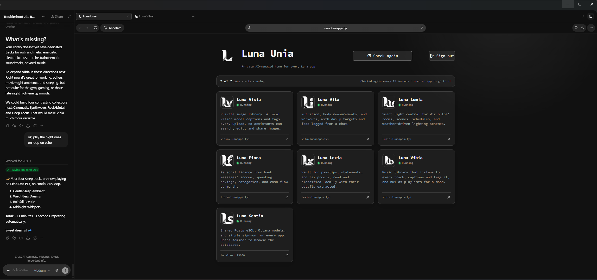
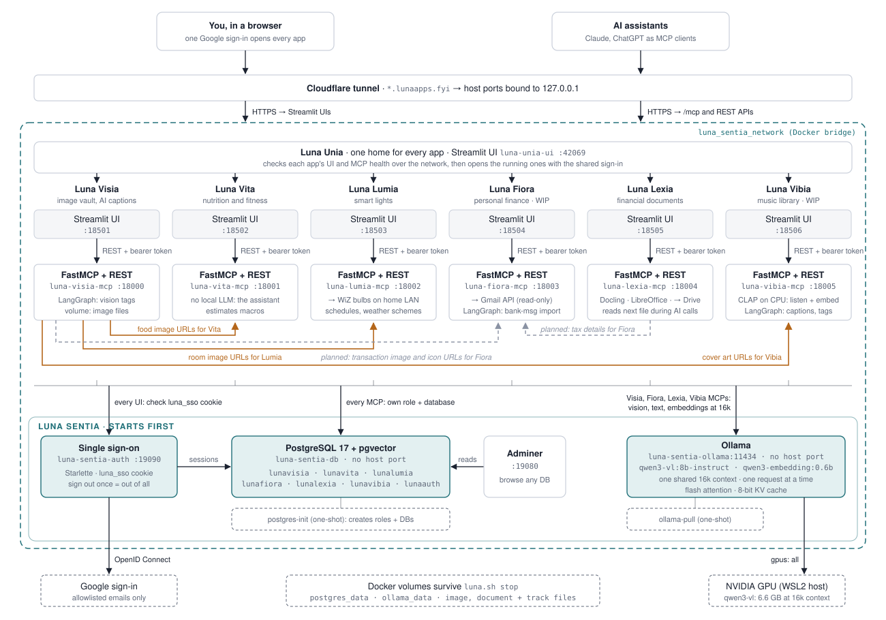

# Luna Unia


## One home for every Luna app

Luna Unia is the front door to the Luna apps. It checks which Luna stacks are running
and shows each one as a card with its icon, name, and description. Pick a running
app to go to it; the shared sign-in means it opens without signing in again.

It has a UI only: no MCP service, no database, and no model calls. It reads nothing
from the apps except whether they answer.

<p align="center">
  
</p>

## Architecture

### Luna ecosystem



Every Luna app is a Streamlit UI plus a FastMCP service on Luna Sentia's
`luna_sentia_network`: its data lives in Sentia's PostgreSQL, people sign in
through Sentia's `auth`, and model calls go to Sentia's Ollama. Orange lines are
Visia image URLs that other apps use: food images for Vita, room images for
Lumia, and cover art for Vibia. Grey dashed lines are planned: links into Fiora
(tax details from Lexia, transaction image and icon URLs from Visia). Luna Unia
is the one home for all of them, on port 42069: it checks which Luna stacks are
running and opens each one with the shared sign-in.

| Component | Technology | Purpose |
| --- | --- | --- |
| UI (`luna-unia-ui`, `:42069`) | Streamlit, httpx | App cards with live status; each running app's card opens it |
| Sign-in | Luna Sentia's `auth` | The shared `luna_sso` session, plus Unia's own allowlist |

## How detection works

Unia joins `luna_sentia_network` and asks every stack's services, all at once, whether
they answer (2 seconds at most each):

| Stack | Checks | Card opens |
| --- | --- | --- |
| Visia, Vita, Lumia, Fiora, Lexia, Vibia | `http://luna-<app>-ui:8501/_stcore/health`, then `http://luna-<app>-mcp:8000/health` | The app's UI |
| Sentia | Adminer (`luna-sentia-adminer:8080`), sign-on (`luna-sentia-auth:8000/health`), and models (`luna-sentia-ollama:11434/api/version`) | Adminer |

- **Running:** every check answers. The card opens the app.
- **`MCP not responding`** (or another service): the UI answers but a service behind it
  does not. The card still opens the app, which may show errors until that service is up.
- **Not running:** the UI does not answer. The card is dimmed and does not open.

The grid checks again every 15 seconds while the page is open; **Check again** checks
at once. Unia finds stacks by these network aliases, so it needs no Docker socket and
sees nothing else on the host. The list of stacks, their descriptions, and their
localhost ports is `LUNA_APPS` in `ui/config.py`; add a new app there.

## Start

Start [Luna Sentia](https://github.com/pranjallk1995/Luna_Sentia) first and wait until
its `auth` service is healthy; Unia needs no database. `../luna.sh start` starts Sentia,
every app, and Unia last.

Create a private `.env` from `.env.example`:

```dotenv
LUNAUNIA_ALLOWED_EMAILS=you@example.com
LUNAUNIA_URL_TEMPLATE=https://{app}.example.com
LUNA_SSO_URL=https://auth.example.com
LUNA_SSO_INTERNAL_URL=http://luna-sentia-auth:8000
```

- `LUNAUNIA_URL_TEMPLATE` is where the cards send the browser: `{app}` becomes `visia`,
  `vita`, `lumia`, `fiora`, `lexia`, or `vibia`. Leave it blank to open each app at its
  localhost port (18501 to 18506). `LUNA<APP>_URL`, such as `LUNAVIBIA_URL`, sets one
  app's address when it does not follow the pattern.
- Luna Sentia's card opens Adminer at `LUNASENTIA_URL` (default
  `http://localhost:19080`). Adminer listens only on localhost, so the link works only
  on the machine running Luna.
- Sign-in goes through Luna Sentia's single sign-on, as in every Luna app; see
  [Single sign-on](https://github.com/pranjallk1995/Luna_Sentia#single-sign-on). With
  `SENTIA_AUTH_COOKIE_DOMAIN` set, Unia must be reached under that domain, like every
  app: route a public hostname such as `unia.example.com` to `127.0.0.1:42069` in your
  tunnel.

```sh
docker compose up -d
```

- UI: <http://127.0.0.1:42069>

## Development workflow

```sh
docker compose up -d --build
docker compose exec ui python -m unittest discover -s tests -t .
```

Tests use a fake network (`httpx.MockTransport`), so they need no running stacks. The
UI follows the shared [UI style guide](UI_STYLE_GUIDE.md); it has no navbar, which the
guide lists under "Known deviations".
