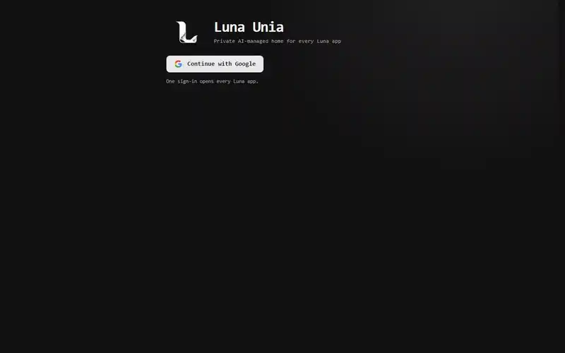
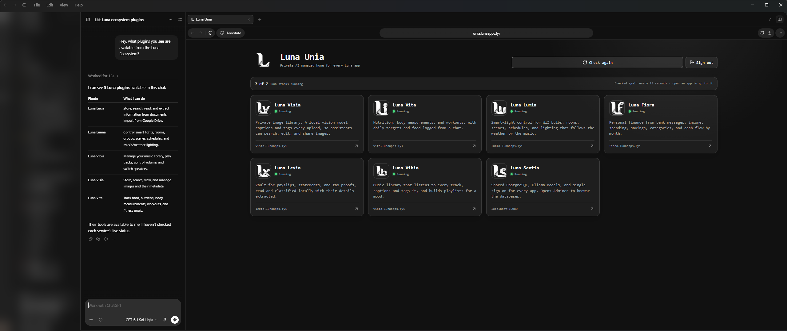

# Luna Unia


**One home for every Luna app.** Unia shows a card for each Luna app, says which ones are running, and opens them
with the shared sign-in, so you never sign in twice.

<p align="center">
  <a href="docs/luna-unia-showcase.mp4"></a>
</p>

## What it does

- **Live status:** each app is **running**, **not running** (dimmed), or running with a service not answering. It
  checks every 15 seconds, or at once with **Check again**.
- **One click in:** a running app's card opens it, already signed in.
- **Only what you can use:** apps the owner hid are left out, and only the owner sees Sentia and Luna Socia.
- **Nothing stored:** a UI only, with no database, no MCP server and no model calls. It never reads the apps' data,
  only whether they answer.

<p align="center">
  
</p>

## Quickstart

Clone Unia and the apps you want beside [Luna Sentia](https://github.com/pranjallk1995/Luna_Sentia), then start
everything. On one machine you need no `.env`:

```sh
git clone https://github.com/pranjallk1995/Luna_Sentia.git
git clone https://github.com/pranjallk1995/Luna_Unia.git
git clone https://github.com/pranjallk1995/Luna_Visia.git        # and any other Luna_<App> you want
./Luna_Sentia/luna.sh start
```

Open <http://localhost:42069> and sign in as Sentia's owner. Who else may use Unia, and a public address, are in
[Getting started](https://github.com/pranjallk1995/Luna_Unia/wiki/Getting-Started).

## Documentation

The [wiki](https://github.com/pranjallk1995/Luna_Unia/wiki) has the full reference:

| Page | What's in it |
| --- | --- |
| [Home](https://github.com/pranjallk1995/Luna_Unia/wiki) | What Unia is |
| [Getting started](https://github.com/pranjallk1995/Luna_Unia/wiki/Getting-Started) | Setup, `.env`, sign-in |
| [Architecture](https://github.com/pranjallk1995/Luna_Unia/wiki/Architecture) | How detection works, who sees what, adding an app |
| [Development](https://github.com/pranjallk1995/Luna_Unia/wiki/Development) | Development workflow and tests |

The UI follows [UI_STYLE_GUIDE.md](UI_STYLE_GUIDE.md).

## Releases and development

Releases are on the [Releases page](https://github.com/pranjallk1995/Luna_Unia/releases). To update: `git pull`, then
`./Luna_Sentia/luna.sh start`. To run your local code and reload it as you edit:
`./Luna_Sentia/luna.sh start --build --watch unia`.
